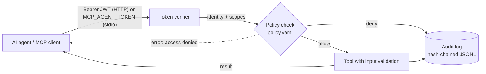

# secure-mcp-server

A reference [Model Context Protocol](https://modelcontextprotocol.io) server that treats every AI agent as an untrusted caller. It shows the controls an enterprise MCP deployment needs before agents touch real systems:

- **Agent identity**: every agent has its own short-lived JWT, so each call is tied to one named caller.
- **Least-privilege tools**: a policy file grants one scope per tool. Unlisted tools are denied by default.
- **Tamper-evident audit log**: every call, allowed or denied, is written as a hash-chained JSON line, with arguments redacted.
- **Input hardening**: path-traversal and symlink-escape protection, size limits, strict ID formats, and no stack traces returned to the model.
- **Two transports**: stdio for local clients and streamable HTTP with bearer auth for shared deployments.

The tools themselves (notes search, ticket CRUD) are deliberately simple. The value is in the layer around them.

## How a call flows



All tools go through one `Guard.run()` path in `server.py`. A tool cannot execute without a verified identity, a matching scope and an audit entry.

## Threats this addresses

| Risk (OWASP Top 10 for LLM Applications 2025) | Control here |
|---|---|
| LLM06 Excessive Agency: an agent calls tools it should not | Per-agent scopes, deny-by-default policy, destructive tools behind a separate admin scope |
| LLM01 Prompt Injection: injected text drives a tool call | Injected calls still need the token's scope; arguments are validated server-side, never trusted |
| LLM02 Sensitive Information Disclosure | Sandboxed file access, redacted audit arguments, generic error messages |
| Forged or replayed credentials | Pinned signing algorithm, `iss`/`aud`/`exp` checks, 1-hour maximum lifetime, unique `jti` per token |
| Covering tracks after misuse | Hash-chained audit log; `verify-audit` detects edited or deleted entries |

## Quick start

Requires Python 3.11+.

```bash
git clone https://github.com/Srinath-VP/secure-mcp-server.git
cd secure-mcp-server
pip install -e ".[dev]"

export MCP_JWT_SECRET="$(python -c 'import secrets; print(secrets.token_urlsafe(48))')"
```

**Issue tokens for two agents with different privileges:**

```bash
export READER_TOKEN=$(secure-mcp-server token --sub research-agent --scope notes:read)
export OPS_TOKEN=$(secure-mcp-server token --sub ops-agent --scope notes:read --scope tickets:write)
```

**Run over streamable HTTP** (clients send `Authorization: Bearer <token>`):

```bash
secure-mcp-server serve --transport http      # http://127.0.0.1:8000/mcp
```

**Run over stdio** (the agent's token comes from the environment):

```bash
MCP_AGENT_TOKEN=$READER_TOKEN secure-mcp-server serve --transport stdio
```

To use it from Claude Desktop or another MCP client over stdio, see [`examples/claude_desktop_config.json`](examples/claude_desktop_config.json).

**Check the audit trail:**

```bash
secure-mcp-server verify-audit                # OK: 12 entries verified
```

## Tools and scopes

| Tool | Scope required | Notes |
|---|---|---|
| `whoami` | `notes:read` | Shows the identity and scopes on this connection |
| `search_notes` | `notes:read` | Searches Markdown files in `sandbox/` |
| `read_note` | `notes:read` | Reads one file; traversal and symlink escapes are refused |
| `create_ticket` | `tickets:write` | Ticket is owned by the calling agent |
| `delete_ticket` | `tickets:admin` | Marked `destructiveHint` so clients can ask for confirmation |

Change access by editing [`policy.yaml`](policy.yaml), not code.

## Audit log format

```json
{"id": "9f2c…", "ts": 1762790400.123, "subject": "research-agent", "client_id": "research-agent",
 "token_id": "4be1…", "tool": "create_ticket", "arguments": {"title": "sha256:3a7bd3e2360a3d29"},
 "decision": "deny", "outcome": "denied", "duration_ms": 0.41,
 "detail": "tool 'create_ticket' requires scope 'tickets:write'",
 "prev_hash": "c1d0…", "hash": "77ae…"}
```

Argument values are fingerprinted, not stored, and keys such as `token`, `password` or `api_key` are replaced with `[REDACTED]`. You can still correlate calls without copying sensitive data into logs.

## Configuration

| Variable | Default | Purpose |
|---|---|---|
| `MCP_JWT_SECRET` | *(required, 32+ chars)* | HMAC key used to verify tokens |
| `MCP_JWT_ISSUER` / `MCP_JWT_AUDIENCE` | `secure-mcp-dev` / `secure-mcp-server` | Expected `iss` and `aud` claims |
| `MCP_AGENT_TOKEN` | | Caller's token for the stdio transport |
| `MCP_POLICY_PATH` | `policy.yaml` | Tool-to-scope policy |
| `MCP_AUDIT_LOG` | `audit.log.jsonl` | Audit log location |
| `MCP_SANDBOX_DIR` | `sandbox` | The only directory file tools can read |
| `MCP_HOST` / `MCP_PORT` / `MCP_PUBLIC_URL` | `127.0.0.1` / `8000` | HTTP bind address and public URL |

For production, replace the local `token` command with your identity provider (Entra ID, Okta, Auth0) and switch `JwtTokenVerifier` to RS256 with the provider's public keys. The rest of the server does not change.

## Tests

```bash
pytest -q
```

The 28 tests cover forged, expired, `alg: none` and wrong-audience tokens; deny-by-default policy; audit tampering and deletion; path traversal and symlink escapes; and end-to-end calls through a real MCP client over both in-process and streamable HTTP transports.

## Project layout

```
src/secure_mcp_server/
  auth.py      # agent identity: issue and verify JWTs
  policy.py    # least-privilege, deny-by-default tool policy
  audit.py     # hash-chained, redacted audit log + verifier
  tools.py     # tool logic and input validation
  server.py    # Guard: identity -> policy -> tool -> audit, and the MCP server
  __main__.py  # CLI: serve, token, verify-audit
```

## License

MIT
